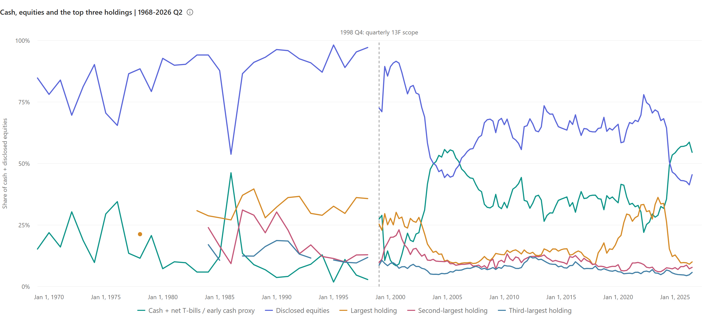

# Berkshire Allocation History

Five historical series for Berkshire Hathaway: cash, disclosed stocks, and the three largest company holdings, each divided by **cash + disclosed stocks**.

**141 observations:** 30 annual observations for fiscal 1968–1997, followed by 111 consecutive quarters from 1998Q4 to 2026Q2. The data were audited on **November 6, 2026** and published on **November 7, 2026**. This is a fixed research snapshot; publication did not refresh the holdings.



[Download the interactive chart](docs/index.html) · [CSV](data/allocation.csv) · [JSON](data/allocation.json) · [Methodology](docs/methodology.md) · [Data dictionary](docs/data-dictionary.md)

Download the HTML and open it in a browser, or serve the repository locally. Its data are embedded; the pinned Data charts 1.2.1 component loads over the internet. GitHub's source-file view does not run the chart.

## What the percentages mean

For each observation, let `C` be disclosed cash-like assets, `S` the disclosed stock portfolio, and `M1`, `M2`, `M3` the largest three company holdings:

```text
cash share   = C / (C + S)
stock share  = S / (C + S)
rank k share = Mk / (C + S), for k = 1, 2, 3
```

The three holdings are already included in `S`. Their lines show concentration within the same denominator; they are not additional asset categories. Rankings are recalculated each period, after combining included share classes of the same company.

The two historical segments have different coverage. Early annual values use the financial reports' disclosed equity market values and a historical cash/short-term-investment proxy. Quarterly values combine Berkshire's main 13F portfolio with the documented cash and Treasury-bill pool. The chart breaks the line at this transition. Neither segment measures the allocation of all Berkshire assets, operating businesses, or every global equity investment.

## Latest observation in this snapshot

**June 30, 2026.** Amounts below are in USD billions; percentages use the unrounded denominator of $658,483,556,246.

| Series | Amount | Share of cash + stocks |
| --- | ---: | ---: |
| Cash-like assets | $359.230 | 54.55% |
| Disclosed 13F securities | $299.254 | 45.45% |
| Largest company: Apple | $65.950 | 10.02% |
| Second-largest: American Express | $51.282 | 7.79% |
| Third-largest: Alphabet | $37.764 | 5.74% |

Alphabet combines its reported share classes. These figures are traceable to the [quarterly report](https://www.berkshirehathaway.com/qtrly/2ndqtr26.pdf) and [13F information table](https://www.sec.gov/Archives/edgar/data/1067983/000119312526352200/56757.xml).

## Observed concentration peaks

Annual and quarterly samples are reported separately. These are maxima among verified observations, not claims about every historical trading day.

| Rank | Annual-report sample, 1968–1997 | Quarterly 13F sample, 1998Q4–2026Q2 |
| --- | --- | --- |
| Second-largest | GEICO, fiscal 1986: **31.10%** | American Express, 2000-09-30: **23.06%** |
| Third-largest | GEICO, fiscal 1989: **18.70%** | IBM, 2012-03-31: **12.16%** |

Second-place values are verified for **126 of 141** observations; third-place values for **124 of 141**. Missing evidence stays `null`. See [ranking gaps](docs/methodology.md#ranking-gaps) and [machine-readable statistics](data/statistics.json).

## Rebuild

From the repository root, using Python 3 and its standard library:

```sh
python scripts/build.py
python scripts/render_chart.py
python scripts/validate.py
```

These commands rebuild the published tables, statistics, and interactive HTML from the included audited inputs. They do not download new filings or refresh the snapshot. The PNG preview is a checked export of the same chart using the pinned Data charts 1.2.1 component; these commands do not regenerate it.

The repository contains derived data and source references. Original annual reports and SEC filings are linked in [the source catalog](data/sources.json); third-party report PDFs are not redistributed. See the [methodology](docs/methodology.md) for amendment handling, accounting-scope changes, source discrepancies, and the limits of historical comparisons.
