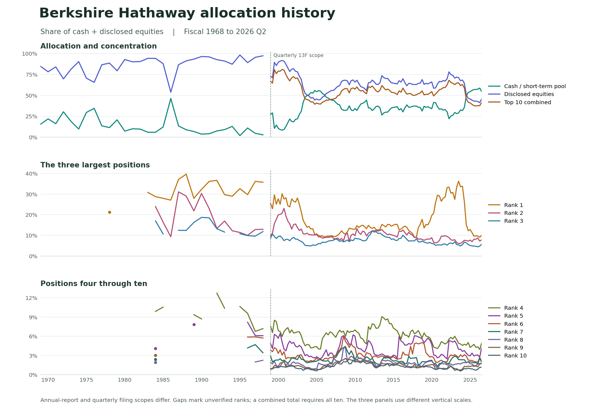

# Berkshire Allocation History

Track Berkshire Hathaway’s cash, disclosed equities, and **the ten largest company positions** at each reporting date. All twelve lines use **cash + disclosed equities** as their denominator. A separate concentration view shows the combined top ten only when every rank is verified.

**141 observations:** 30 annual observations for fiscal 1968–1997, followed by 111 consecutive quarters from 1998Q4 to 2026Q2. The data were audited on **November 6, 2026** and published on **November 7, 2026**. The November 14, 2026 extension adds ranks four through ten to this fixed snapshot, without changing the reporting period.



[Open the interactive chart](https://okht.github.io/berkshire-allocation-history/) · [HTML source](docs/index.html) · [Top ten by date (CSV)](data/top-ten-holdings.csv) · [Combined top ten (CSV)](data/top-ten-totals.csv) · [Allocation CSV](data/allocation.csv) · [JSON](data/allocation.json) · [Methodology](docs/methodology.md) · [Data dictionary](docs/data-dictionary.md)

Open the hosted chart, download the HTML and open it in a browser, or serve the repository locally. Its data are embedded; the pinned Data charts 1.2.1 component loads over the internet. GitHub's source-file view does not run the chart.

## What the percentages mean

For each observation, let `C` be disclosed cash-like assets, `S` the disclosed stock portfolio, and `Mk` the value of the company ranked `k`:

```text
cash share   = C / (C + S)
stock share  = S / (C + S)
rank k share = Mk / (C + S), for k = 1 through 10
combined top ten = (M1 + ... + M10) / (C + S), when all ten are verified
```

The ten holdings are already included in `S`. Their lines show concentration within the same denominator; they are not additional asset categories. Rankings are recalculated each period, after combining included share classes of the same company.

The two historical segments have different coverage. Early annual values use the financial reports' disclosed equity market values and a historical cash/short-term-investment proxy. Quarterly values combine Berkshire's main 13F portfolio with the documented cash and Treasury-bill pool. The chart breaks the line at this transition. Neither segment measures the allocation of all Berkshire assets, operating businesses, or every global equity investment.

## Latest observation in this snapshot

**June 30, 2026.** Amounts below are in USD billions; percentages use the unrounded denominator of $658,483,556,246.

| Series | Amount | Share of cash + stocks |
| --- | ---: | ---: |
| Cash-like assets | $359.230 | 54.55% |
| Disclosed 13F securities | $299.254 | 45.45% |
| Largest company: Apple | $65.950 | 10.02% |
| Second-largest: American Express | $51.282 | 7.79% |
| Third-largest: Alphabet | $37.764 | 5.74% |
| Fourth: Coca-Cola | $32.508 | 4.94% |
| Fifth: Bank of America | $27.544 | 4.18% |
| Sixth: Chevron | $13.986 | 2.12% |
| Seventh: Occidental Petroleum | $12.868 | 1.95% |
| Eighth: Chubb | $11.670 | 1.77% |
| Ninth: Moody’s | $11.173 | 1.70% |
| Tenth: Kraft Heinz | $7.691 | 1.17% |
| **Ten companies combined** | **$272.438** | **41.37%** |

Alphabet combines its reported share classes. These figures are traceable to the [quarterly report](https://www.berkshirehathaway.com/qtrly/2ndqtr26.pdf) and [13F information table](https://www.sec.gov/Archives/edgar/data/1067983/000119312526352200/56757.xml).

## Historical percentage ranges

The table shows the lowest and highest observed shares of **cash + disclosed equities** across 30 annual reports (FY 1968–1997) and 111 quarter ends (1998Q4–2026Q2). The last column gives the range for the 111 quarters alone. Each rank follows the company occupying that position on the reporting date.

| Series | Verified dates (of 141) | Full-sample low | Full-sample high | Quarterly range |
| --- | ---: | --- | --- | ---: |
| Cash-like assets | 141 | 1.84% · FY 1994 | 58.67% · 2026Q1 | 8.44%–58.67% |
| Rank 1 | 128 | 9.06% · 2017Q3 · Wells Fargo | 39.66% · FY 1987 · Capital Cities/ABC | 9.06%–36.23% |
| Rank 2 | 126 | 6.05% · 2023Q2 · Bank of America | 31.10% · FY 1986 · GEICO | 6.05%–23.06% |
| Rank 3 | 124 | 4.42% · 2025Q4 · Bank of America | 18.70% · FY 1989 · GEICO | 4.42%–12.16% |
| Rank 4 | 121 | 3.93% · 2026Q1 · Bank of America | 12.72% · FY 1991 · Capital Cities/ABC | 3.93%–9.07% |
| Rank 5 | 116 | 2.46% · 2021Q4 · Kraft Heinz | 8.19% · FY 1995 · American Express | 2.46%–6.43% |
| Rank 6 | 115 | 1.93% · 2020Q3 · Moody’s | 6.01% · 2008Q2 · ConocoPhillips | 1.93%–6.01% |
| Rank 7 | 115 | 1.27% · 2020Q3 · U.S. Bancorp | 4.70% · FY 1996 · McDonald’s | 1.27%–4.41% |
| Rank 8 | 114 | 0.90% · 2004Q2 · H&R Block | 4.20% · 2008Q2 · Kraft Foods | 0.90%–4.20% |
| Rank 9 | 111 | 0.73% · 2023Q3 · DaVita | 2.56% · 2008Q3 · U.S. Bancorp | 0.73%–2.56% |
| Rank 10 | 111 | 0.56% · 2023Q3 · HP Inc. | 2.24% · 2009Q3 · Wesco Financial | 0.56%–2.24% |

All quarters have ten verified company positions. Early annual reports identify fewer positions and use cash and short-term investment figures whose scope varies by year. Thus the 1.84% cash low in FY 1994 and the 8.44% quarterly low in 2000Q2 come from different reporting scopes. Ranks 9 and 10 have quarterly evidence only. [Explore the ranges on the chart](https://okht.github.io/berkshire-allocation-history/#historical-percentage-ranges) · [Download ranges and endpoint details (CSV)](data/percentage-ranges.csv) · [Ranking coverage](docs/methodology.md#ranking-gaps)

Across the 111 quarterly filings, the ten companies combined reached **80.95%** of cash plus equities on 2000-06-30. At the last date in this snapshot their combined share was **41.37%** on that denominator, or **91.04%** on an equities-only denominator.

The [rank-by-date file](data/top-ten-holdings.csv) retains all ten slots at every date. The [totals file](data/top-ten-totals.csv) leaves incomplete periods blank. Select a date on the live chart to look up the company behind each line. [Machine-readable statistics](data/statistics.json)

## Rebuild

From the repository root, using Python 3 and its standard library:

```sh
python scripts/build.py
python scripts/render_chart.py
python scripts/validate.py
```

These commands rebuild the published tables, statistics, and interactive HTML from the included audited inputs. They do not download new filings or refresh the snapshot. The online chart keeps its pinned Data charts 1.2.1 component. To regenerate the optional three-panel PNG from the same chart data, run `python scripts/render_preview.py` in an environment with Matplotlib.

The repository contains derived data and source references. Original annual reports and SEC filings are linked in [the source catalog](data/sources.json); third-party report PDFs are not redistributed. See the [methodology](docs/methodology.md) for amendment handling, accounting-scope changes, source discrepancies, and the limits of historical comparisons.
